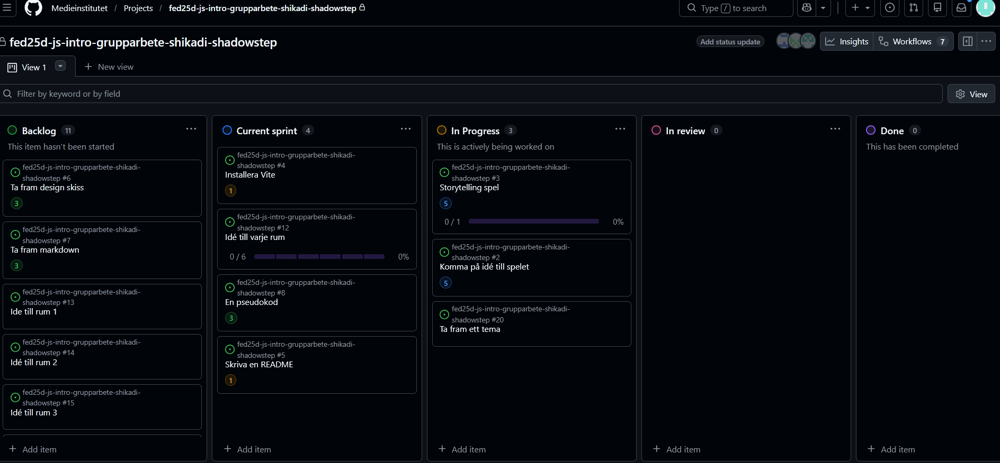

# Daily Standup: veckodag 2026-02-16

Project board:

Dagens scrum master: Markus Jönsson

## Namn: Sandra Hellström
Närvarande
## Namn: Alex Truong
Närvarande
## Namn: Amanda Andersson
Närvarande
## Namn: Mohammed Yasin
Närvarande

## Namn: Jennie Modd
Närvarande

## Planering för veckan

Komma på ett team för rummen, en överhängande story för spelet.

Vi har bestämt oss för ett tema (Sogor, spelaren ska lösa pussesl för att komma vidare till nästa rum).

Sagan vi bestämde os för blev Alice i underlandet, varje rum blir då en ny utmaning för Alice .

Exempel på pussel och problem: 
Alice Äventyr: Den Magiska Labyrinten
Spelets handling
Alice har tappat bort den Vita Kaninen och hans klocka. För att hitta hem igen måste hon följa kaninspåren genom Underlandet, hjälpa vännerna hon möter och samla ihop klockans delar.
Enkla och roliga mekaniker
Storleks-magi (En knapp):Istället för svåra menyer har barnet två enkla knappar (eller föremål på skärmen): en kaka för att bli jättestor och en saftflaska för att bli pytteliten.
Exempel: "Åh nej, en grind är låst! Ät kakan, bli stor som ett hus och kliv helt enkelt över grinden."
Exempel: "Hålet i väggen är för litet. Drick saften, bli liten som en mus och spring igenom."
Följ kaninen (Vägvisaren): För att barnet aldrig ska gå vilse finns det lysande kanintassar på marken som visar exakt vart man ska gå för att komma vidare i sagan.
Ingen "Game Over": Man kan inte förlora eller "dö". Om man ramlar utanför en kant svävar Alice ner som ett paraply och landar mjukt på fötterna igen.
Roliga små minispel (Uppdrag)
Hattmakarens Tekopps-torn: Hjälp Hattmakaren att stapla färgglada tekoppar på varandra. Det är som ett enkelt pussel där man drar och släpper koppar i olika färger.
Måla rosorna röda: Hjärter Dam har råkat få vita rosor! Barnet får använda en magisk pensel för att "måla" de vita blommorna röda genom att bara dra fingret eller musen över dem.
Cheshire-kattens kurragömma: Katten syns bara när han ler. Barnet ska klicka på de glittrande leendena som dyker upp bakom träd och svampar för att få tips om vägen.

## Planering för morgondagen:

Wireframe/ lauyout (visuelt)
Påbörjar projectet i guthub dvs skapar det nödvändliga dokumenten.

